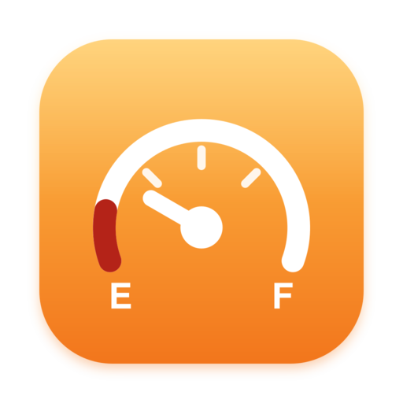
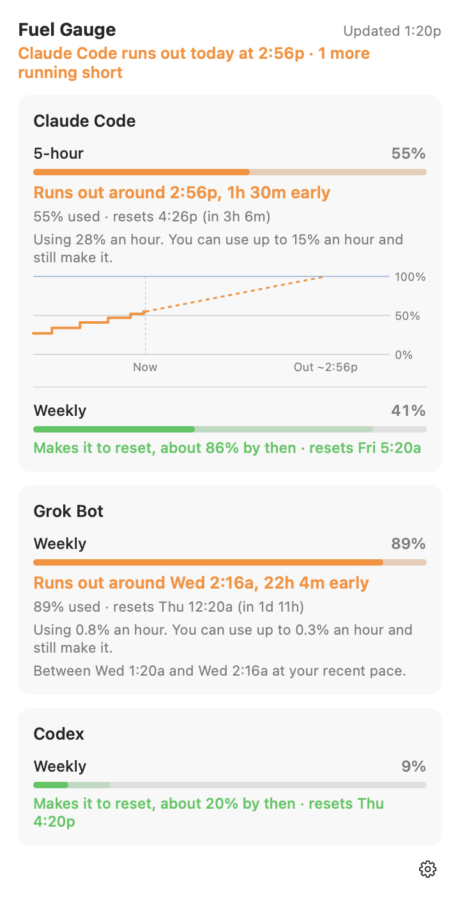

<p align="center">
  
</p>

<h1 align="center">Fuel Gauge</h1>

<p align="center">Know if you'll make it to reset. A free menu bar app that forecasts when you'll hit your Claude Code, Codex, Grok Bot, and Cursor limits.</p>

<p align="center">
  <a href="https://fuelgauge.app">fuelgauge.app</a> ·
  <a href="https://github.com/coreyhaines31/fuelgauge/releases/latest">Download</a> ·
  <a href="#install">Install</a> ·
  <a href="#first-run">First run</a> ·
  <a href="#command-line">Command line</a> ·
  <a href="#troubleshooting">Troubleshooting</a>
</p>

---

Your coding plan has limits: a 5-hour window, a weekly window, sometimes a monthly one. A percentage tells you how much you've used. It doesn't tell you whether, at the pace you're going, you'll run out before the window resets. Fuel Gauge does. It watches your pace and says, in plain words, "Makes it to reset" or "Runs out around 3:40p, 1h 20m early", so you can keep going, switch to a cheaper model, or save the big build for after the reset.

It's free, the source is on GitHub, and your usage never leaves your Mac.

<p align="center">
  <picture>
    <source media="(prefers-color-scheme: dark)" srcset=".github/images/panel-dark.png">
    
  </picture>
</p>

<p align="center"><sub>Shown with sample data.</sub></p>

## What it does

- **Forecasts each limit.** For every window (Claude Code's 5-hour and weekly, Codex's, Grok Bot's weekly, Cursor's) it measures your pace over the recent stretch and says whether you'll make it to the reset, or when you'll run out.
- **Shows a range, not a guess dressed up as a fact.** "Between 2:50p and 4:30p at your recent pace." Until it has about 10 minutes of readings, it says "Learning your pace" instead of making one up.
- **Tells you your budget.** "You can use up to 9% an hour and still make it." That's the number that changes how you work.
- **Lives in the menu bar.** A fuel pump fills with the fuel left in whichever limit is closest to running out. It turns orange when one will run out before it resets, and red when one is out.
- **Shows up inside Claude Code.** A strip under the prompt: `⛽ 5h 55% out ~12:05p · wk 41% ok`. If you already have a status line, it stays, with the forecast under it.
- **Warns you once.** A notification when a limit will run out at least 30 minutes before it resets, and optionally at 50%, 80%, and 95% used.
- **Works from Terminal.** The [`fuelgauge` command](#command-line) prints the forecast and exits with code 2 when a limit will run out, so an agent can check before starting a long task.
- **Reads only what's already on your Mac.** No sign-in, no browser cookies, no Full Disk Access, no keychain, no telemetry. Checking for updates is the only time it goes online, plus Cursor if you turn it on.

## Install

Requires macOS 14 Sonoma or later.

**Homebrew:**

```sh
brew install --cask coreyhaines31/tap/fuelgauge
open -a "Fuel Gauge"
```

**Or download** `FuelGauge.dmg` from [Releases](https://github.com/coreyhaines31/fuelgauge/releases/latest), open it, and drag **Fuel Gauge** to **Applications**.

**Or ask your coding agent.** Paste this into Claude Code or Codex:

```text
Install Fuel Gauge on my Mac: run `brew install --cask coreyhaines31/tap/fuelgauge`, open Fuel Gauge, then run `fuelgauge install-statusline` and `fuelgauge status`.
```

## First run

Click the fuel pump in the menu bar.

| Tool | What to do | Where the numbers come from |
| --- | --- | --- |
| Claude Code | Click **Turn On** in the panel (or run `fuelgauge install-statusline`). | Claude Code passes its 5-hour and weekly limits to its status line after each reply. Fuel Gauge becomes the status line, saves each reading, and prints the forecast. Your `settings.json` is backed up first, and an existing status line keeps showing. Claude limits appear for Pro and Max plans. |
| Codex | Nothing. | Codex records its limits in its session logs in `~/.codex/sessions`. The last 8 days are read on first launch, so weekly forecasts start right away. |
| Grok Bot | Nothing. | Grok Bot saves its weekly usage on your Mac while it's open. |
| Cursor | Turn it on in **Settings › Tools** (it's off by default). | Cursor keeps no usage on your Mac, so Fuel Gauge asks cursor.com every 10 minutes, signed in with the Cursor app's own sign-in. |

Forecasts need about 10 minutes of readings while you work. Until then a card says "Learning your pace". Choose which tools to track in **Settings › Tools**.

## Reading a card

| Line | Meaning |
| --- | --- |
| **Makes it to reset, about 70% by then** | At your recent pace, you'll still have fuel when the window resets. |
| **Runs out around 3:40p, 1h 20m early** | At your recent pace, you'll hit the limit before it resets. |
| **Out until 5:00p** | The limit is used up. |
| **Learning your pace** | Not enough readings yet. |
| Using 6% an hour | Your pace over the recent stretch: the last hour for a 5-hour window, the last day for a weekly one. |
| You can use up to 9% an hour | The fastest pace that still lasts until the reset. |

It's an estimate from your recent pace, not a promise. A burst of work speeds it up and a break slows it down.

## Command line

The app includes a `fuelgauge` command. Homebrew puts it on your PATH; otherwise use **Settings › General › Install…**.

```sh
fuelgauge status              # every limit, in plain words; exits 2 if one will run out before it resets
fuelgauge status --json       # the same, for scripts and agents
fuelgauge history --days 2    # the readings behind the forecasts
fuelgauge install-statusline  # make Fuel Gauge Claude Code's status line
fuelgauge uninstall-statusline
```

**For agents.** Add this to `CLAUDE.md` or `AGENTS.md` (it's also under **Settings › General › Prompt for AI agents**):

```text
Before starting a long or expensive task, run `fuelgauge status`. If it exits with code 2, a Claude Code, Codex, or Grok Bot limit is forecast to run out before it resets: tell me which one and when, and ask before starting, or switch to a cheaper model. `fuelgauge status --json` has the details.
```

## Privacy

Fuel Gauge reads three things, all on your Mac: the JSON Claude Code passes to its status line, Codex's session logs, and Grok Bot's usage cache. If you turn on Cursor, it also asks cursor.com for your Cursor usage every 10 minutes, using the sign-in the Cursor app stores; nothing else is sent. It saves readings (tool, limit, percent, reset time) in `~/Library/Application Support/Fuel Gauge/Readings` for about two months. It never signs in to anything, reads browser cookies, or asks for Full Disk Access, and it sends nothing anywhere. Codex reset tracking is on by default and contacts OpenAI through your installed Codex CLI; you can turn it off in Settings › Resets. Otherwise, apart from Cursor, the only network request is Sparkle's update check against this repo's releases.

## Troubleshooting

**No Claude Code card.** Turn on the status line (panel or `fuelgauge install-statusline`), then send Claude a message: readings arrive with each reply. Claude Code only shares limits on Pro and Max plans. If you use Claude on the web or the desktop app, that usage shows up at your next Claude Code reply.

**"Learning your pace" doesn't go away.** It needs readings at least 10 minutes apart. For Claude Code that means a couple of replies 10 minutes apart; for Grok Bot, Grok Bot has to be open.

**The menu bar icon is missing.** On a crowded menu bar, macOS hides icons that don't fit beside the notch. Quit an app or two, or use a menu bar manager like [Coat Check](https://coatcheckformac.com).

**My old status line disappeared.** Run `fuelgauge uninstall-statusline` to put it back. A backup of your settings is at `~/.claude/settings.json.fuelgauge-backup`.

## Uninstall

Put Claude Code's status line back first, then remove the app:

```sh
fuelgauge uninstall-statusline
brew uninstall --cask --zap fuelgauge
```

Without Homebrew, drag **Fuel Gauge** from Applications to the Trash, and trash `~/Library/Application Support/Fuel Gauge`.

## Available usage resets

Open **Settings › Resets** to track resets you can redeem when you need more usage.

- **Codex:** Reset tracking is on by default when Codex is tracked. Fuel Gauge asks your installed, signed-in Codex CLI
  for the available count every five minutes and shows the next known expiration. You can refresh it
  immediately after redeeming a reset in Codex's `/usage` menu. Missing data is shown as unknown, not zero.
  Turn it off in Settings › Resets; an explicit opt-out is preserved across updates.
- **Claude:** Open Claude Usage from the card, then save a manual count and optional next expiration
  in Settings › Resets. Claude's status line does not expose this balance. The card labels the count
  as manual and shows when you recorded it; update it after redemption or switching accounts.
- **Grok Bot:** No saved-reset balance is currently tracked. Its documented additional usage credits
  are distinct from redeemable resets.

Fuel Gauge never redeems a reset. Codex reset tracking is on by default and contacts OpenAI
through the Codex CLI using its existing sign-in. Fuel Gauge does not read or store Codex credentials.

## Building from source

Needs Xcode 16 or later, [XcodeGen](https://github.com/yonaskolb/XcodeGen), and SwiftLint (`brew install xcodegen swiftlint`).

```sh
xcodegen generate
xcodebuild -project FuelGauge.xcodeproj -scheme FuelGauge -derivedDataPath build/DerivedData \
  DEVELOPMENT_TEAM="" CODE_SIGN_IDENTITY="-" build
open "build/DerivedData/Build/Products/Debug/Fuel Gauge.app"
```

The forecasting logic lives in `Packages/FuelGaugeCore` (`swift test` there). `swift run fuelgauge-dev` prints what the readers find on your Mac. Debug builds take `--demo` (sample data) and `--snapshot <file.png>`. See [CONTRIBUTING.md](CONTRIBUTING.md).

## License

Free to use. The source is available under the [Functional Source License 1.1, MIT Future License](LICENSE): you can read, modify, and use it for anything except a competing product, and each version becomes MIT two years after release. The name and icon are covered by [TRADEMARK.md](TRADEMARK.md).
